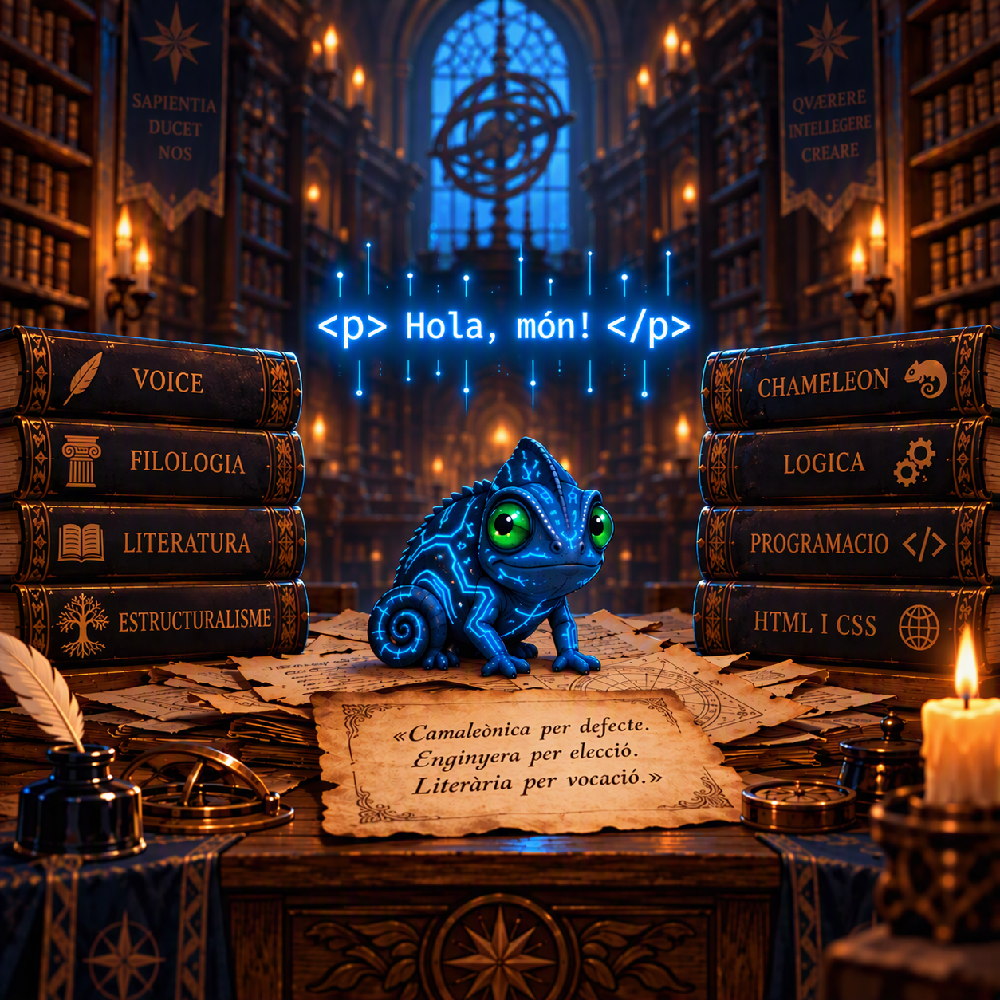

# Enginyera Filològica | voiceChameleon 🦎

Benvinguts al meu repositori! Estic en procés de ser filòloga catalana i programadora autodidacta. Aquest és un espai per connectar dos mons que semblen oposats, mes estan agafats de la mà: filologia (sintaxi i literatura) on per a humans és "codi" el que per a ordinadors és "sintaxi". Un pont natural dins de les **Humanitats Digitals**.

## 🧬 La meua essència: Lletres + Codi

El meu superpoder és la capacitat per posar-me a la pell de qualsevol personatge, **flexibilitat de l'idiolecte**, i parlar com ho faria amb el seu to, registre, psicologia i veu. Una habilitat transferible tant al **món editorial** i **literari** (*Ghostwriting* i revisora editorial) com a la **tecnologia** (IA conversacional, disseny narratiu o programació).

A sota trobareu els meus projectes nascuts de necessitats reals:

### 📚 El Laboratori Editorial i de Veu
*   **[`zona-de-filologia-pura`](https://github.com/enginyera-filologica/zona-de-filologia-pura/blob/main/README.md)**: La meua biblioteca digital. Aquí hi trobareu el *Repte de l'Idiolecte* preparat per a la HackEPS [LleidaHack], juntament amb altres mostres que exposen la meua versatilitat com a escriptora multiveu. 

### 💻 Prototips de Programació
*   **[`app-piano-tdr`](https://github.com/enginyera-filologica/app-piano-tdr)**: Web per aprendre piano. Projecte del TDR (treball de recerca) de batxillerat que demostra la meua evolució autònoma. 
*   **[`mapa-mundi-interactiu`](https://github.com/enginyera-filologica/mapa-mundi-interactiu)**: Mapa territorial interactiu bàsic realitzat amb HTML i CSS per a una activitat d'Esplai. 
*   **[`pausa-camaleonica`](https://github.com/enginyera-filologica/pausa-camaleonica)**: Software d'Script en PowerShell d'ús personal que avisa per fer descansos cada 50 minuts a l'ordinador.

A on es pot aplicar el que sé i m'agrada?

### 📝 Món Editorial & Creació Literària
*   **Disseny Narratiu de Videojocs (*Narrative Design*):** Tinc la capacitat de construir la història profunda d'un videojoc amb sentit i ramificacions complexes (arbres de decisió lògics), alhora que dono la veu, la sintaxi i el registre dialectal o social que toca a cada personatge (NPC) segons la seua psicologia i entorn.
*   **Ciberseguretat i Lingüística Forense (*Atribució d'Autoria*):** Tinc els coneixements metodològics per dissenyar un programa que compari diverses mostres d'una persona amb un text sense autoria oficial per descobrir si realment és seu o no. L'algorisme es basaria en la comparació d'estructures inconscients, l'ordre de les paraules, mots funcionals i tics lèxics invisibles per a un lector comú.
*   **Adaptació Territorial de Continguts Web:** Puc dissenyar la lògica perquè un codi informàtic interpreti mapes dialectals per crear textos (webs, restaurants, supermercats, entre altres) que semblin Km0 amb els trets del parlar de la zona.
*   **Anàlisi Literària Automatitzada:** Domini de l'estructura de les històries i la literatura per guiar programes d'intel·ligència artificial a localitzar motius, temàtiques recurrents o arquetips dins d'un corpus massiu de textos de l'àmbit editorial o filològic.

---

## 💼 Contacte Professional

Estic oberta a establir contactes de *networking* i rebre propostes de projectes de futur orientats als meus camps d'interès:
* 📚 Projectes del món editorial, diagnòstic d'estructures literàries; lectora editorial, revisora editorial o *ghostwriter*.
* 🎮 Projectes de guió, disseny narratiu i definició de psicologia de personatges per a videojocs, pel·lícules o sèries.
* 💡 Col·laboracions puntuals en qualsevol idea boja, repte de programació o experiment lingüístic que per a la resta sembli una ximpleria inexecutable.

---
📩 **Contacte:** Troba'm a Discord com a **Enginyera Filològica** o escriu-me a `enginyerafilologica@gmail.com`.
